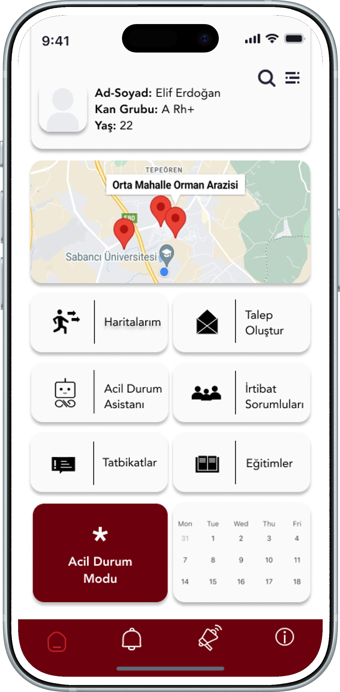

<div align="center">

# Sollen Web

### The digital home of Sollen Technologies and ISGenius

A bilingual product website for field safety technology, with a 3D product showcase, scroll-driven storytelling, and a responsive interface.


[Overview](#overview) · [Product screens](#product-screens) · [Run locally](#run-locally) · [Architecture](#architecture) · [Development](#development)

</div>

---

## Overview

Sollen brings its field safety offering to the web through **ISGenius** product stories, application previews, and a clear path to contact the team. The website presents emergency response, evacuation and assembly, training, risk awareness, and emergency contact workflows.

This repository contains the **public-facing website**: its interface, animations, translations, and visual assets. The mobile application, operational platform, IoT services, and their backend implementations are maintained separately.

### Experience

- **English and Turkish.** A shared translation dictionary powers the interface. Language selection persists locally and updates the document language.
- **3D product presentation.** React Three Fiber renders a floating, textured phone display. The hero includes an image fallback for rendering failures.
- **Motion and navigation.** GSAP timelines, ScrollTrigger reveals, animated counters, and Lenis scrolling connect the page sections.
- **Responsive layouts.** A floating navigation bar, alternating product stories, and five solution tabs adapt across screen sizes.
- **Local preferences.** Language and cookie preference choices are stored in the browser. The current codebase does not load an analytics or advertising SDK.
- **Direct contact.** The contact action opens the visitor's email application using `mailto:`.

## Product screens

Application mockups used in the website. Personal details shown in these assets are fictional demo data.

<table>
  <tr>
    <th align="center">ISGenius overview</th>
    <th align="center">Emergency response</th>
    <th align="center">Risk awareness</th>
  </tr>
  <tr>
    <td align="center"></td>
    <td align="center"></td>
    <td align="center"></td>
  </tr>
</table>

## Run locally

Use **Node.js 20.9 or newer** and npm. Node.js 24 is used for the current verification.

```bash
git clone https://github.com/bedirhancceylan/sollen-web.git
cd sollen-web
npm ci
npm run dev
```

Open [localhost:3000](http://localhost:3000). The current website requires no database or application credentials. The build downloads Roboto through `next/font/google`, so the build environment needs access to Google Fonts.

For a production build:

```bash
npm run build
npm start
```

## Architecture

| Layer | Implementation |
| --- | --- |
| Framework | Next.js App Router with React and strict TypeScript |
| Styling | Tailwind CSS, CSS theme tokens, and responsive layouts |
| 3D | Three.js, React Three Fiber, and Drei |
| Animation | GSAP and ScrollTrigger |
| Scrolling | Lenis synchronized with the GSAP ticker |
| Localization | React context, typed EN/TR dictionaries, and local persistence |
| Assets | Local product screenshots, logos, and Next.js image optimization |

```text
src/
├── app/
│   ├── layout.tsx          # Providers, font, navigation, and global UI
│   ├── page.tsx            # Page section composition
│   └── globals.css         # Theme and global styles
├── components/
│   ├── 3d/                 # Phone scene, camera, lighting, and fallback boundary
│   ├── layout/             # Intro, navigation, language, and smooth scrolling
│   ├── sections/           # Hero, product, solutions, statistics, and contact
│   └── ui/                 # Shared interface components
├── hooks/                  # Navigation helpers
└── lib/                    # Translations, content constants, and GSAP setup
public/
├── logos/                  # Brand and organization assets
└── screens/                # Application mockups
```

The home page follows this sequence:

**Hero → Trust → Why Sollen → ISGenius features → Statistics → Solutions → Contact**

The 3D canvas loads on the client. The page keeps navigation, content, and contact available independently of the 3D scene.

## Development

| Command | Purpose |
| --- | --- |
| `npm run dev` | Start the development server |
| `npm run build` | Build and type-check the production application |
| `npm start` | Serve the production build |
| `npm run lint` | Run ESLint |

### Content and branding

- Edit shared copy in [`src/lib/i18n.ts`](src/lib/i18n.ts).
- Update navigation, screenshot mappings, and content constants in [`src/lib/constants.ts`](src/lib/constants.ts).
- Edit solution-specific EN/TR content in [`SolutionsSection.tsx`](src/components/sections/SolutionsSection.tsx).
- Adjust colors and typography in [`globals.css`](src/app/globals.css).
- Replace product assets in `public/screens/`, preserving the paths referenced by the components.

### Security and deployment

Keep credentials, private keys, deployment settings, and real personal data outside the repository. `.env*` files and `.vercel/` are ignored by Git. The current website has no server-side contact-mail endpoint; contact is handled by the visitor's email application.

Production browser source maps and the framework's `X-Powered-By` header are disabled. Response headers restrict framing, MIME sniffing, referrer disclosure, and browser access to camera, microphone, and geolocation.

Deploy to a Next.js-compatible Node.js host. Configure any future server-side secrets through the hosting provider, and never expose secrets through `NEXT_PUBLIC_*` variables. Review dependency updates and run `npm audit` before releases.

---

<div align="center">

**Sollen Technologies · ISGenius**

[Contact the team](mailto:info@sollen.com.tr)

</div>
